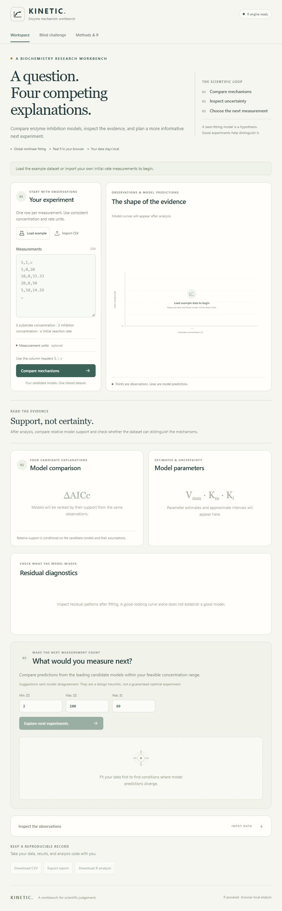
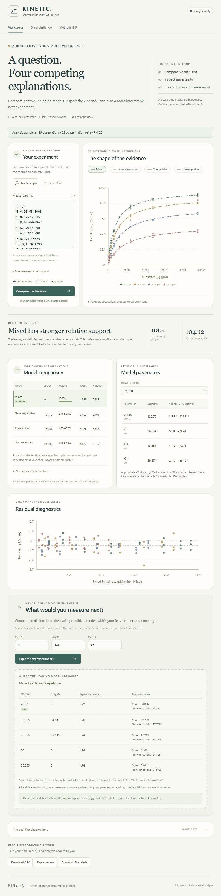

# KINETIC — Enzyme inhibition workbench

**Connect to your VPN before opening KINETIC.**

**[Open KINETIC](https://kinetic-enzyme-workbench.glacialsesame2.chatgpt.site)**

KINETIC asks which reversible enzyme inhibition models are consistent with measured initial rates and which additional measurements could help distinguish them. The public app runs without a login.

## Why this matters in biochemistry

Inhibitor screening can show that a compound reduces enzyme activity. To investigate how inhibition varies with substrate concentration, researchers can compare initial rates measured at several substrate and inhibitor levels. KINETIC fits competitive, uncompetitive, noncompetitive and mixed inhibition models to the same dataset. It displays the curves, estimated parameters, residuals and relative model support, then suggests measurements where the two leading models predict different rates. This is a way to compare biochemical hypotheses and plan follow-up measurements. A model ranking alone cannot establish how an inhibitor binds to the enzyme. [Assay Guidance Manual](https://www.ncbi.nlm.nih.gov/books/NBK92001/)

## Use the app

1. Select **Load example** or import a CSV with the headers `S,I,v` for substrate concentration, inhibitor concentration and initial rate. Keep units consistent and put each replicate on a separate row.
2. Select **Compare mechanisms**. The app fits all four models, compares them by AICc and displays the residuals and approximate parameter intervals. The **Methods & R** tab contains the R code.
3. Change the allowed concentration bounds under **Explore next experiments** to see where the leading models diverge. Use **Blind challenge** to test the workflow on synthetic data before revealing the generating model.
4. Download the CSV, analysis report or R script from the results page to keep a reproducible record.

The analysis runs in the browser using webR. The first visit needs an internet connection to load the R runtime.

## App screenshots

**Start screen**



**Analysis results**



The results screen shows the built-in mixed-inhibition example with 96 observations across 32 concentration pairs. The app compares its fit with the three other candidate models.

## Run from this repository

Start the local server from the repository root.

```sh
python -m http.server 8000 --directory dist
```

Open `http://localhost:8000`. In GitHub Codespaces, use `npm run dev` and open forwarded port `8000` from the **Ports** panel.

## Assignment documents

- [Example prompts for building and revising the app](PROMPTS.md)
- [Evaluation and test evidence](EVALUATION.md)
- [Reflection](REFLECTION.md)
